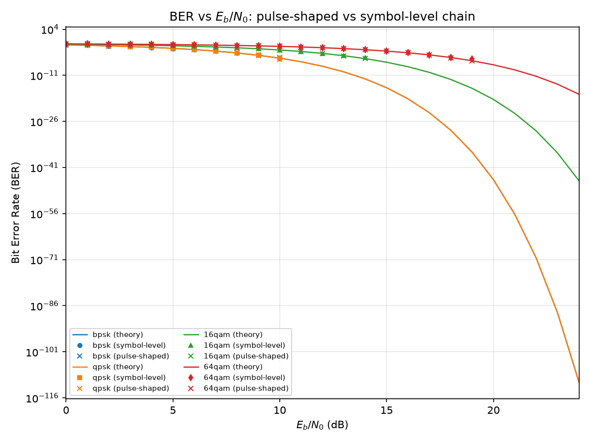
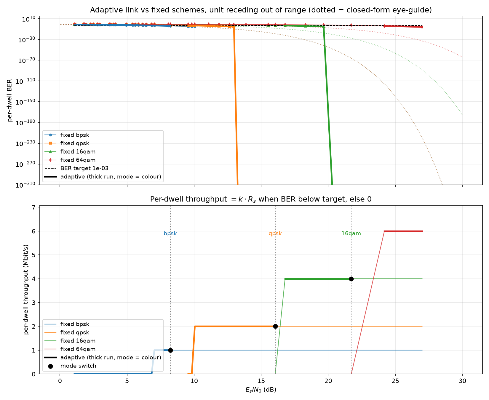

# Adaptive Modulation Simulation

A pure-Python simulation of an **adaptive modulation (AMC)** link over a time-varying
channel. The receiver estimates SNR from pilot symbols in real time and switches between
BPSK, QPSK, 16-QAM and 64-QAM using a threshold table with hysteresis.

Built with only `numpy`, `scipy` and `matplotlib` — no MATLAB, no SDR, no hardware.



## Why adaptive modulation?

A fixed modulation scheme forces a bad trade-off:

- Pick a robust scheme (BPSK) and you keep the link alive when the channel is poor, but
  waste throughput when it is good.
- Pick a dense scheme (64-QAM) and you get high throughput in good conditions, but the
  link collapses as soon as SNR drops.

This project simulates the alternative: measure the channel, then use the densest
modulation that still meets a target BER. The result is a link that degrades gracefully
instead of falling off a cliff.

## Features

- Gray-coded BPSK / QPSK / 16-QAM / 64-QAM mapping and demodulation.
- Root-raised-cosine (RRC) pulse shaping, up/downsampling and matched filtering.
- AWGN, flat Rayleigh fading and path loss.
- Pilot-based Es/N0 estimation.
- Threshold-based mode selection with **hysteresis** to prevent mode chatter.
- Monte Carlo BER sweeps checked against closed-form theory.
- Throughput and link-availability comparison: adaptive vs. each fixed scheme.
- Interactive Tkinter demo and a headless demo mode for servers/CI.

## Quick start

```bash
git clone https://github.com/georgian3768/adaptive-modulation.git
cd adaptive-modulation
python3 -m venv .venv
source .venv/bin/activate
pip install -r requirements.txt
python -m unittest discover -s tests
python main.py
```

All commands are run from the repository root. Generated plots and tables land in
`results/`.

## Usage

| Command | What it does |
|---|---|
| `python main.py` | BER sweeps vs. theory plus the pulse-shaping regression |
| `python main.py --adaptive-vs-fixed` | Adaptive vs. fixed schemes: `results/adaptive_vs_fixed.png`, `results/availability.csv` |
| `python demo.py --fast --save` | Headless live demo; writes the final frame to `results/` |
| `python interactive_demo.py` | Interactive GUI: change channel conditions and watch mode switching live |
| `python interactive_demo.py --headless 40` | Same chain without a display; prints 40 dwells |
| `python verify_thresholds.py` | Threshold table, BER corroboration and no-chatter gate |
| `python -m unittest discover -s tests` | Unit test suite |

## Communication chain

```
bits -> framing -> modulator (BPSK / QPSK / 16-QAM / 64-QAM)
     -> RRC pulse shaping -> channel (AWGN + optional flat fading + path loss)
     -> matched filter + sync -> SNR estimator -> demodulator -> BER / recovered bits

feedback: SNR estimator -> modulation selector (threshold table + hysteresis)
```

## Modules

| File | Purpose |
|---|---|
| `modem.py` | Bit <-> symbol mapping for BPSK/QPSK/16-QAM/64-QAM (Gray-coded) |
| `pulse_shape.py` | RRC filter, upsample/downsample |
| `channel.py` | AWGN, optional Rayleigh fading, path loss |
| `receiver.py` | Matched filter, sync, SNR estimator |
| `adapt.py` | Threshold table, mode-switching logic, throughput/availability |
| `main.py` | Simulation driver, Monte Carlo loops, plotting |
| `interactive_demo.py` | Interactive GUI with live channel controls |
| `demo.py` | Scripted headless/live demo |
| `verify_thresholds.py` | Threshold and no-chatter verification |
| `tests/` | Unit tests per module |
| `results/` | Generated plots, tables and `summary_report.md` |

## How the adaptation works

For each scheme the simulation measures the Es/N0 needed to stay below a target BER
(default `1e-3`). Those values become the base thresholds. A hysteresis margin is applied
around each threshold:

- **Up-shift** at `threshold + margin` — upgrade only when the channel is clearly good enough.
- **Down-shift** at `threshold - margin` — downgrade only when the link is clearly failing.

The gap prevents the selector from oscillating between adjacent modes when SNR hovers
around a boundary. The default margin is 1 dB (0.5 dB on each side); see `adapt.py` and
`verify_thresholds.py`.

## Results

The checked-in results were produced with the default seed and parameters:

- `results/ber_all_schemes.png` — simulated BER vs. theoretical curves.
- `results/adaptive_vs_fixed.png` — throughput/availability of adaptive vs. fixed schemes.
- `results/availability.csv` — raw availability numbers.
- `results/link_block_diagram.png` and `.svg` — end-to-end block diagram.
- `results/summary_report.md` — threshold table and headline numbers.

Headline result from the receding-unit trace: adaptive modulation reaches **1.18 Mbit/s**
mean throughput vs. **0.70 Mbit/s** for the best fixed scheme (QPSK), while keeping every
on-air dwell below the BER target. See `results/summary_report.md` for the full table.



*Adaptive modulation tracks the channel: it gives up throughput only while the link is
poor, instead of falling off a cliff like a fixed dense scheme.*

`PRESENTATION.md` contains a 10–15 minute walkthrough of the demo, the key numbers and a
Q&A reference.

## Extending the simulation

The code is deliberately small and flat so it is easy to modify:

- Add a modulation scheme in `modem.py` and a threshold in `adapt.py`.
- Change the channel model in `channel.py` (e.g. Rician fading, frequency-selective fading).
- Replace the pilot-based estimator in `receiver.py` with a different SNR estimator.
- Adjust the target BER, hysteresis margin, pilot overhead or Monte Carlo length in `main.py`.

## Known limitations

- Ideal synchronization is assumed (perfect timing, phase and carrier recovery).
- AWGN and flat fading only; no frequency-selective channel.
- No forward error correction (FEC).
- Simulation only — no SDR or over-the-air testing.

These are intentional scope choices, not hidden assumptions.

## Testing

The suite uses the standard library `unittest` runner:

```bash
python -m unittest discover -s tests -v
```

The same command runs in GitHub Actions on Python 3.10–3.13.

## License

MIT — see [LICENSE](LICENSE).

## Credits

Originally developed as a team project. Maintained by
[@georgian3768](https://github.com/georgian3768). See
[CONTRIBUTORS.md](CONTRIBUTORS.md).
